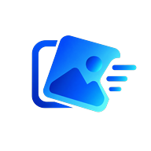

<div align="center">



# SwipeClean

**Limpia tu galería deslizando. Conserva lo que importa, manda a la papelera lo que no.**

[](https://github.com/andresvd95/DesarrolloMovil/releases/latest/download/SwipeClean-beta-free.apk)


</div>

---

## ¿Qué es?

SwipeClean es una app Android nativa para ordenar fotos y videos del teléfono de a uno, con gestos tipo swipe. Lo que descartas va a una papelera recuperable, así que nada se borra por accidente. Mientras limpias, la app lleva estadísticas del espacio liberado y desbloqueas logros.

> **Beta Free** — esta es la versión gratuita en fase beta. Es completamente funcional y no tiene anuncios ni pagos. Puede contener errores; si encuentras uno, [abre un issue](https://github.com/andresvd95/DesarrolloMovil/issues).

## Funciones

| | |
|---|---|
| 👉 **Swipe para decidir** | Derecha conserva, izquierda manda a la papelera, arriba deja para después. |
| ↩️ **Deshacer** | Revierte la última acción con un toque. |
| 🗑️ **Papelera recuperable** | Restaura lo que descartaste o vacíala cuando estés seguro (con confirmación). |
| 🔍 **Filtros y orden** | Fotos, videos, capturas de pantalla, por álbum, tamaño o fecha. |
| 🧬 **Duplicados** | Detecta fotos repetidas para liberar espacio rápido. |
| 📊 **Dashboard y logros** | Espacio liberado, archivos revisados y logros desbloqueados. |
| 🌓 **Tema claro / oscuro** | Ajustes de apariencia y preferencias de limpieza. |
| 🔐 **Permisos correctos** | Permisos de medios granulares en Android 13+, y clásicos en versiones anteriores. |

## Instalación (APK)

1. Toca el botón **Descargar APK** de arriba desde tu teléfono Android (o descárgalo en el PC y pásalo al teléfono).
2. Abre el archivo `SwipeClean-beta-free.apk`.
3. Si Android lo pide, permite **instalar apps de origen desconocido** para tu navegador o gestor de archivos.
4. Abre SwipeClean, crea tu cuenta y concede el acceso a fotos y videos.

**Requisitos:** Android 7.0 (API 24) o superior · ~5 MB.

Todas las versiones están en la página de [Releases](https://github.com/andresvd95/DesarrolloMovil/releases).

## Cómo funciona

```
Splash → Login / Registro → Home
                             ├── Swipe deck (revisión por gestos)
                             ├── Duplicados
                             ├── Papelera
                             ├── Dashboard (estadísticas y logros)
                             └── Ajustes
```

La app lee los medios reales del dispositivo con `MediaStore`, aplica filtros con `MediaQuery` y guarda la papelera, estadísticas y logros en una base local con Room. No envía tus fotos a ningún servidor: todo ocurre en el teléfono.

```
Activity  →  Repository  →  MediaStore / Room DAO
```

## Para desarrolladores

### Tecnologías

| Herramienta | Detalle |
|---|---|
| Lenguaje | Java 11 |
| Android SDK | min 24 · target 36 |
| Librerías | AndroidX, Material Design, Room |
| UI | Activities + layouts XML |
| Build | Gradle 9.3.1 (AGP 9.x) |

### Estructura

```
app/src/main/java/com/example/layouts/
├── SplashActivity / LoginActivity / RegisterActivity
├── HomeActivity            # pantalla principal
├── SwipeDeckActivity       # revisión por gestos y filtros
├── TrashActivity           # recuperación y vaciado confirmado
├── DashboardActivity       # estadísticas, logros y almacenamiento
├── SettingsActivity        # tema y preferencias
├── auth/                   # SessionManager
├── ui/                     # ThemeController, InsetsUtil
├── gallery/                # MediaItem
└── data/                   # repositorios, DuplicateFinder, MediaQuery
    └── db/                 # AppDatabase, DAOs y entidades Room
```

### Compilar

```bash
git clone https://github.com/andresvd95/DesarrolloMovil.git
cd DesarrolloMovil
./gradlew assembleDebug
```

Abre el proyecto en Android Studio y ejecútalo en un emulador o dispositivo.

> **Windows con acentos en el usuario** (p. ej. `C:\Users\Andrés`): si Gradle falla con `Unable to establish loopback connection`, usa una carpeta temporal sin acentos:
>
> ```powershell
> $env:JAVA_TOOL_OPTIONS="-Djdk.net.unixdomain.tmpdir=C:/gtmp"; ./gradlew.bat assembleDebug
> ```

**APK firmado (release):** crea `signing/keystore.properties` con `storeFile`, `storePassword`, `keyAlias` y `keyPassword`, y ejecuta `./gradlew assembleRelease`. La carpeta `signing/` está en `.gitignore` y nunca se sube.

### Pruebas

```bash
./gradlew test
```

Pruebas unitarias en `app/src/test/java/com/example/layouts/`: repositorios (medios, papelera, estadísticas, logros, ajustes), `MediaQuery`, `DuplicateFinder`, `DashboardSummary` y `SessionManager`.

## Hoja de ruta

- [x] Beta Free: swipe, papelera, filtros, duplicados, dashboard y logros
- [ ] Mejoras en la detección de duplicados
- [ ] Tutorial interactivo de primer uso
- [ ] Versión Pro (duplicados sin límite, sin anuncios)

## Autor

**Andres VD** — [@andresvd95](https://github.com/andresvd95)
